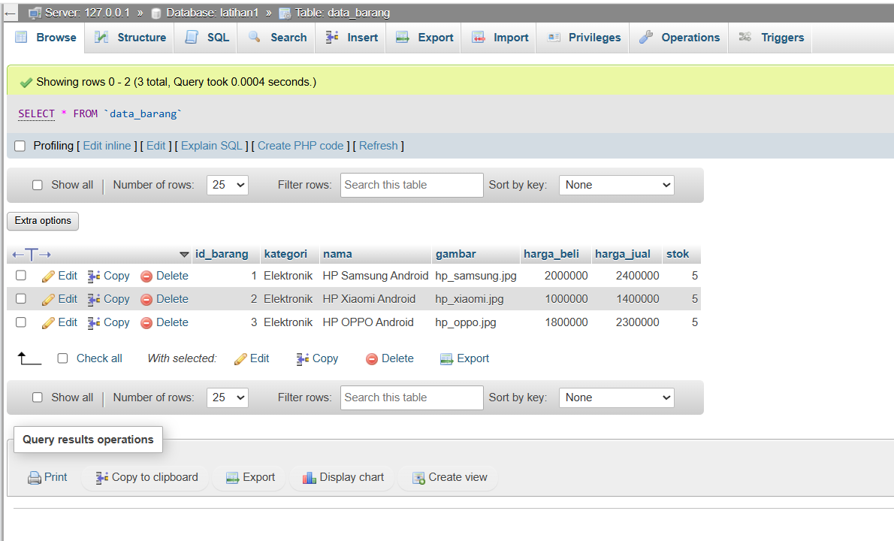
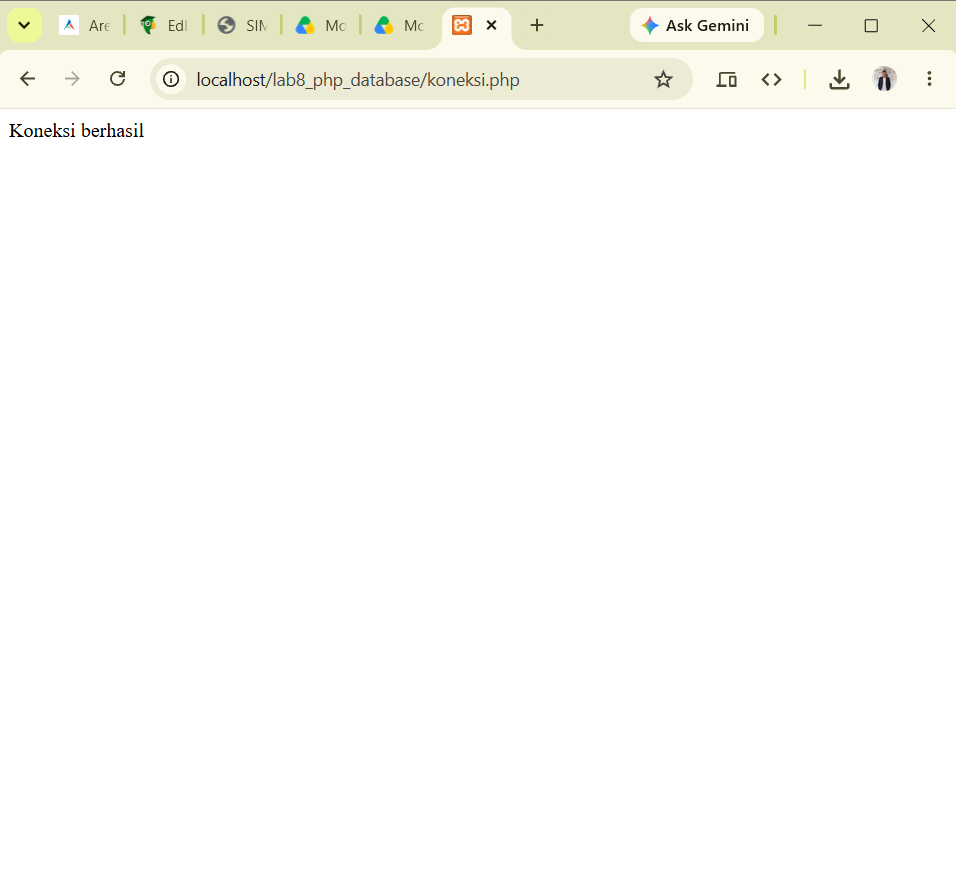
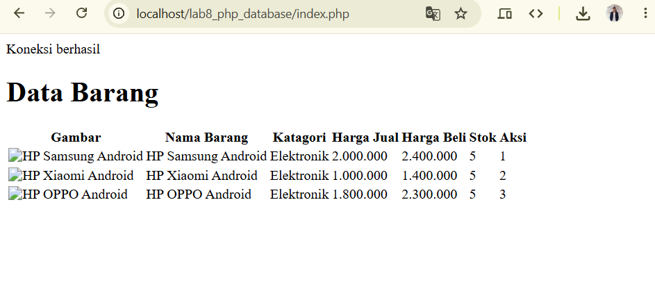
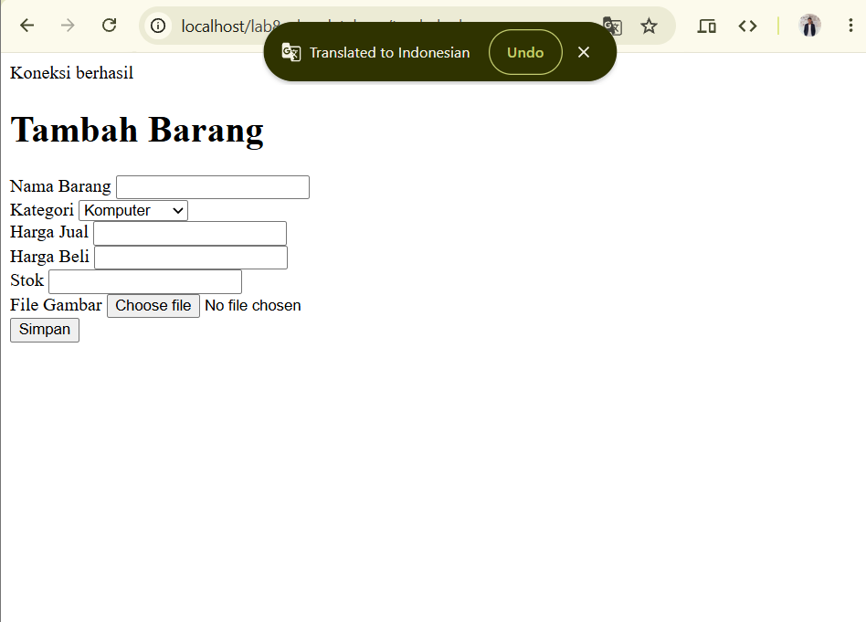
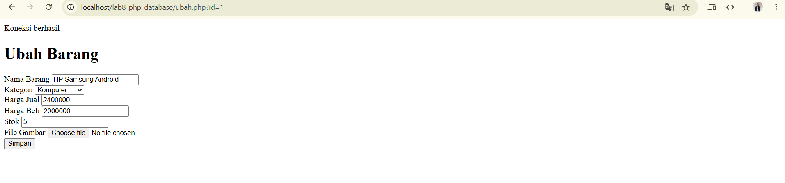
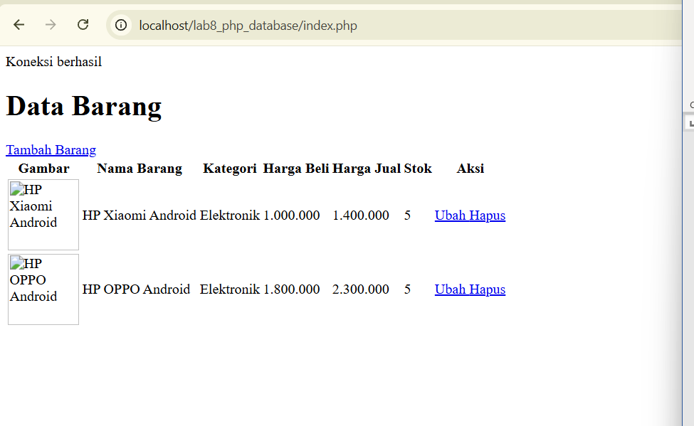

# Lab8Web - Praktikum 8: PHP dan Database MySQL (CRUD)

| | |
|---|---|
| **Nama** | [paulinus risaldi harjo] |
| **NIM** | [312510452] |
| **Kelas** | [I251D] |
| **Mata Kuliah** | Pemrograman Web |

## Tujuan

1. Memahami konsep dasar database.
2. Memahami konsep dasar CRUD menggunakan PHP.
3. Membuat program CRUD sederhana menggunakan PHP dan MySQL.

## Alat dan Bahan

- XAMPP (Apache, MySQL/MariaDB) dan phpMyAdmin
- Visual Studio Code
- Browser (Google Chrome)

## Struktur Folder

```
lab8_php_database/
├── gambar/
├── koneksi.php
├── index.php
├── tambah.php
├── ubah.php
├── hapus.php
└── style.css
```

## Langkah Praktikum

### 1. Persiapan

Jalankan **Apache** dan **MySQL** pada XAMPP Control Panel sampai berstatus aktif. Buat folder `lab8_php_database` di dalam `htdocs` (`C:\xampp\htdocs\lab8_php_database`), lalu buat subfolder `gambar` untuk menyimpan gambar yang diunggah. Buka folder proyek dengan VSCode.

### 2. Membuat Database dan Tabel

Buka `http://localhost/phpmyadmin/`, lalu jalankan perintah berikut pada tab **SQL**.

```sql
CREATE DATABASE latihan1;

CREATE TABLE data_barang (
  id_barang INT(10) AUTO_INCREMENT PRIMARY KEY,
  kategori VARCHAR(30),
  nama VARCHAR(50),
  gambar VARCHAR(100),
  harga_beli DECIMAL(10,0),
  harga_jual DECIMAL(10,0),
  stok INT(4)
);

INSERT INTO data_barang (kategori, nama, gambar, harga_beli, harga_jual, stok)
VALUES
('Elektronik', 'HP Samsung Android', 'hp_samsung.jpg', 2000000, 2400000, 5),
('Elektronik', 'HP Xiaomi Android', 'hp_xiaomi.jpg', 1000000, 1400000, 5),
('Elektronik', 'HP OPPO Android', 'hp_oppo.jpg', 1800000, 2300000, 5);
```

Hasil pada tab **Browse**: tabel `data_barang` berisi 3 data.



### 3. Koneksi Database (`koneksi.php`)

File ini menghubungkan PHP dengan database menggunakan `mysqli_connect()`. Jika koneksi gagal, program menampilkan pesan lalu berhenti dengan `die()`.

```php
<?php
$host = "localhost";
$user = "root";
$pass = "";
$db   = "latihan1";

$conn = mysqli_connect($host, $user, $pass, $db);
if ($conn == false)
{
    echo "Koneksi ke server gagal.";
    die();
} else echo "Koneksi berhasil";
?>
```

Halaman menampilkan tulisan **Koneksi berhasil**, artinya koneksi sudah benar.



### 4. Menampilkan Data - Read (`index.php`)

`index.php` menyertakan `koneksi.php`, menjalankan `SELECT * FROM data_barang`, lalu menampilkan hasilnya dalam tabel HTML dengan perulangan `while` dan `mysqli_fetch_array()`.

```php
<?php
include("koneksi.php");
$sql = 'SELECT * FROM data_barang';
$result = mysqli_query($conn, $sql);
?>
...
<?php while($row = mysqli_fetch_array($result)): ?>
    <td><?= $row['nama'];?></td>
    ...
<?php endwhile; ?>
```

Ketiga data barang tampil. Gambar belum tampil karena berkas gambar belum ada di folder `gambar`, sehingga browser hanya menampilkan teks alternatif.



### 5. Menambah Data - Create (`tambah.php`)

Formulir memakai `method="post"` dan `enctype="multipart/form-data"`. Setelah tombol **Simpan** ditekan, gambar dipindahkan ke folder `gambar` dengan `move_uploaded_file()`, data disimpan dengan `INSERT`, lalu pengguna diarahkan kembali ke `index.php`.

```php
$sql  = 'INSERT INTO data_barang (nama, kategori, harga_jual, harga_beli, stok, gambar) ';
$sql .= "VALUE ('{$nama}', '{$kategori}', '{$harga_jual}', '{$harga_beli}', '{$stok}', '{$gambar}')";
$result = mysqli_query($conn, $sql);
header('location: index.php');
```



### 6. Mengubah Data - Update (`ubah.php`)

Halaman menerima `id` lewat URL (`$_GET['id']`), mengambil data barang tersebut, lalu menampilkannya pada formulir. Saat disimpan, data diperbarui dengan `UPDATE ... WHERE id_barang`. Halaman dibuka dengan `ubah.php?id=1` atau lewat tautan **Ubah** di `index.php`.

```php
$sql  = 'UPDATE data_barang SET ';
$sql .= "nama = '{$nama}', kategori = '{$kategori}', ";
$sql .= "harga_jual = '{$harga_jual}', harga_beli = '{$harga_beli}', stok = '{$stok}' ";
$sql .= "WHERE id_barang = '{$id}'";
```



### 7. Menghapus Data - Delete (`hapus.php`)

`hapus.php` menerima `id`, menjalankan `DELETE`, lalu kembali ke `index.php`. File ini dipanggil lewat tautan **Hapus** pada kolom Aksi.

```php
<?php
include_once 'koneksi.php';
$id = $_GET['id'];
$sql = "DELETE FROM data_barang WHERE id_barang = '{$id}'";
$result = mysqli_query($conn, $sql);
header('location: index.php');
?>
```

Setelah data HP Samsung Android dihapus, tersisa dua data. Kolom Aksi menampilkan tautan **Ubah** dan **Hapus**.



## Kendala dan Penyelesaian

- **Peringatan "Kunci array id tidak terdefinisi" pada `ubah.php`**: halaman dibuka tanpa parameter `id`. Solusinya membuka lewat tautan **Ubah** atau menambahkan `?id=` pada URL.
- **`enctype` harus `multipart/form-data`** (satu kata utuh) agar unggah gambar berfungsi.
- **Gambar tidak tampil**: berkas gambar belum tersedia di folder `gambar`.

## Kesimpulan

Aplikasi CRUD sederhana dengan PHP dan MySQL berhasil dibuat. Operasi Create, Read, Update, dan Delete pada tabel `data_barang` berjalan melalui `tambah.php`, `index.php`, `ubah.php`, dan `hapus.php` yang terhubung ke database `latihan1` lewat `koneksi.php`.
